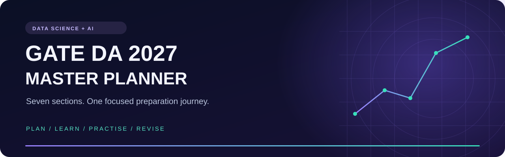

<div align="center">



<br>

**Turn a large syllabus into a clear next step.**

A preparation workspace for GATE Data Science & Artificial Intelligence — bringing your roadmap, topic checklists, practice links and study downloads together.

[](#seven-sections-one-workspace)
[](#under-the-hood)
[](#make-it-your-daily-starting-point)

### [Open the planner ↗](https://loki0406.github.io/GATE-DA-2027-Master-Planner/)

[Explore the features](#a-home-for-your-preparation) · [Get study materials](#your-study-materials-in-one-place) · [Upload a ZIP](#add-materials-without-editing-code)

</div>

---

## A home for your preparation

**Less time searching. More time understanding.**

| Plan with purpose | Learn with structure | Practise with intent |
| :--- | :--- | :--- |
| A 100-day roadmap that gives each study phase a place. | Seven syllabus sections with topic checklists and learning resources. | Links to previous-year questions and mock tests, alongside a daily tracker. |

- **Preparation dashboard** — get your bearings and jump into a subject.
- **Daily checklist** — keep track of completed study blocks.
- **Study resources** — find learning and practice links in one place.
- **Section ZIP Downloads** — choose a subject, then download its available PPT or PDF collection.
- **Syllabus viewer** — consult the bundled source document while planning.
- **Light and dark appearance** — choose your preferred reading style.

## Make it your daily starting point

**01 · Choose** a topic from your current section.  
**02 · Understand** the concept and work through examples.  
**03 · Practise** questions and record what went wrong.  
**04 · Review** your mistakes and tick off completed work.

The included roadmap runs from **6 October 2026 to 5 February 2027**. It is a study schedule, not a statement of your examination date.

> **Your progress stays in your browser.** Checklists use local storage; they do not automatically sync across devices. Clearing site data or resetting progress removes those saved checklists.

## Seven sections. One workspace.

| Section | Study area |
| :---: | :--- |
| **01** | Probability & Statistics |
| **02** | Linear Algebra |
| **03** | Calculus & Optimization |
| **04** | Programming, Data Structures & Algorithms |
| **05** | Database Management & Warehousing |
| **06** | Machine Learning |
| **07** | Artificial Intelligence |

## Your study materials, in one place

Open **Section ZIP Downloads** in the planner sidebar. Every subject has separate **PPT ZIP** and **PDF ZIP** cards.

**Start with Probability & Statistics:** the Section 1 PPT collection contains **40 topic presentations and 969 slides**, including explanations, formulas, worked examples and practice solutions.

### [↓ Get the Section 1 PPT collection](https://raw.githubusercontent.com/loki0406/GATE-DA-2027-Master-Planner/main/ppts/section-1.zip)

Extract the archive and open its **INDEX.html** to browse the topics.

| What you see | What it means |
| :--- | :--- |
| **Available** | The deployed ZIP was detected and can be downloaded. |
| **Coming soon** | That ZIP is not available at its expected location yet. |
| **Checking availability…** | The planner is checking the file. |
| **Unable to check** | The check failed; refresh or try again later. |

The website checks availability on page load and when the browser window regains focus. PPT and PDF availability are independent. The live planner is the place to check the latest uploads.

<a id="add-materials-without-editing-code"></a>

<details>
<summary><strong>📦 Add materials without editing code</strong></summary>

Create a real ZIP archive, give it the exact filename below, and upload it to the matching folder on the website's deployment branch.

| Section | PPT archive | PDF archive |
| :---: | :--- | :--- |
| 1 | `ppts/section-1.zip` | `pdfs/section-1.zip` |
| 2 | `ppts/section-2.zip` | `pdfs/section-2.zip` |
| 3 | `ppts/section-3.zip` | `pdfs/section-3.zip` |
| 4 | `ppts/section-4.zip` | `pdfs/section-4.zip` |
| 5 | `ppts/section-5.zip` | `pdfs/section-5.zip` |
| 6 | `ppts/section-6.zip` | `pdfs/section-6.zip` |
| 7 | `ppts/section-7.zip` | `pdfs/section-7.zip` |

1. Open the `ppts` or `pdfs` folder on GitHub.
2. Choose **Add file → Upload files**.
3. Upload the correctly named ZIP and commit.
4. Wait for the website deployment to complete.
5. Refresh the live planner. The download becomes available automatically.

Use lowercase filenames with no spaces. Files *inside* each archive can have descriptive names. Renaming a PPT or PDF extension to `.zip` does not create an archive.

**No availability flags or JavaScript edits are required.**

</details>

<details>
<summary><strong>🛠 Run the planner locally</strong></summary>

Clone the repository and serve it with Python:

```bash
git clone https://github.com/loki0406/GATE-DA-2027-Master-Planner.git
cd GATE-DA-2027-Master-Planner
python -m http.server 8000
```

Open **http://localhost:8000** in your browser.

Use a local HTTP server for automatic ZIP checks. Opening `index.html` directly as a local file does not provide the same HTTP download-check behaviour.

</details>

## Under the hood

A static frontend built with **HTML, CSS and JavaScript**, with browser local storage for progress.

| File or folder | Responsibility |
| :--- | :--- |
| `index.html` | Page structure, sidebar and study views |
| `styles.css` | Layout, colours and responsive styling |
| `app.js` | Navigation, progress and planner interactions |
| `data.js` | Syllabus, resources and roadmap data |
| `downloads.js` | Section cards and automatic ZIP availability checks |
| `ppts/` | PowerPoint ZIP collections |
| `pdfs/` | PDF ZIP collections |
| `assets/` | Repository presentation assets |
| `DA_SYLLABUS_2025_2024.pdf` | Bundled reference PDF |
| `gate-logo.png`, `second-logo.png` | Website branding |

## Make the next study session count

Found a broken link, a material error or a useful improvement? [Open an issue](https://github.com/loki0406/GATE-DA-2027-Master-Planner/issues) with the section name and a clear description.

This is an independent preparation project. Check official GATE sources for current syllabus, examination dates and instructions; this planner is not an official GATE publication.

---

<div align="center">

**Built by [Lokesh · loki0406](https://github.com/loki0406)**

*One topic understood. One mistake corrected. One step forward.*

[Open the planner](https://loki0406.github.io/GATE-DA-2027-Master-Planner/) · [Browse PPTs](ppts/) · [Browse PDFs](pdfs/)

</div>
